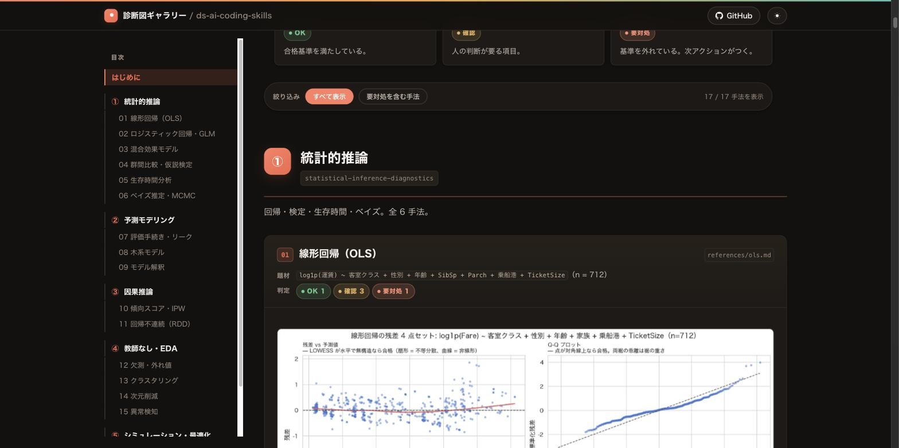

<div align="center">


# ds-ai-coding-skills

[](https://github.com/atsushi-green/ds-ai-coding-skills/actions/workflows/ci.yml)
[](https://www.python.org/)
[](https://docs.astral.sh/uv/)
[](https://docs.astral.sh/ruff/)
[](https://pola.rs/)
<br>
[](https://docs.anthropic.com/en/docs/claude-code)
[](https://github.com/features/copilot)
[](https://openai.com/codex/)
[](LICENSE)


</div>

---

## 関連リンク

| | リンク | 内容 |
|:-:|---|---|
| 📊 | [**診断図ギャラリー**](https://atsushi-green.github.io/ds-ai-coding-skills/) | 各 `*-diagnostics` skill が「必ず出す」と定めた図を、実データで出力して並べたもの |
| 📝 | [**データサイエンティストのためのAGENTS.mdとSkills**](https://zenn.dev/green_tea/articles/d310e5cf809190) | ルーター文書（`AGENTS.md`）と、Python・SQL・データ処理・可視化などの基本 skill の設計 |
| 📝 | [**続・データサイエンティストのためのSkills:分析手法×診断可視化セット**](https://zenn.dev/green_tea/articles/55d2761106ee74) | `*-diagnostics` skill 群（図と値をセットで出させる仕組み）の設計と動作例 |

## セットアップ

### 前提条件

- Python 3.13（`.python-version` に書いてあり、`uv sync` がこの版で環境を作ります）
- [uv](https://docs.astral.sh/uv/) がインストール済みであること

### インストール

```bash
uv sync
```

### 主要コマンド

```bash
uv sync                                              # 依存関係のインストール・同期
uv run pytest                                         # テスト実行
uv run ruff check .                                   # リント
uv run ruff format .                                  # フォーマット
uv run mypy src                                       # 型チェック
uv run python scripts/check_no_raw_data_commit.py     # rawデータのコミットチェック
uv run python scripts/check_no_sensitive_patterns.py   # 秘密情報パターンの検出
uv run python scripts/validate_agent_docs.py           # エージェント文書の検証
bash scripts/run_quality_checks.sh                     # 全品質チェック一括実行
```

## ディレクトリ構成

```
.
├── AGENTS.md                          # Copilot / Codex 用ルーター（CLAUDE.md と同内容）
├── CLAUDE.md                          # Claude Code 用ルーター（ハードルール・スキルルーティング）
├── .github/
│   ├── workflows/ci.yml               # GitHub Actions CI
│   ├── instructions/                  # パス別補助指示（Copilot の applyTo 用）
│   └── prompts/                       # 再利用プロンプト（Copilot）
├── .claude/
│   └── skills/                        # 作業別スキルの唯一の置き場（3ツール共通。旧スラッシュコマンドを含む）
│                                      #   *-diagnostics は2段構成: ルーター SKILL.md + references/<method>.md
├── .agents/
│   └── skills -> ../.claude/skills    # Codex 用シンボリックリンク
├── docs/
│   ├── agent/                         # このリポジトリ固有の知識のみ（概要・データカタログ・指標定義）
│   └── gallery/                       # 診断図ギャラリー（GitHub Pages で公開。図はデモの出力をメンテナの手元で変換して配置）
├── data/
│   ├── raw/                           # 元データ（不変・gitignore対象）
│   ├── external/                      # 外部データ（不変・gitignore対象）
│   ├── interim/                       # 中間加工データ
│   └── processed/                     # 最終加工データ
├── notebooks/                         # 分析用Notebook
├── outputs/
│   ├── figures/                       # グラフ・図
│   ├── tables/                        # 集計テーブル
│   └── reports/                       # レポート
├── scripts/                           # CI・検証スクリプト
│   └── skill_eval/                    #   skill 発火テスト（run_skill_eval.py から手動実行）
├── src/analysis_project/              # 再利用可能なPythonモジュール
└── tests/                             # テスト
```

## 診断図ギャラリーの見方

各 `*-diagnostics` skill が「実行したら必ず出す」と定めた図を、実データ（Titanic ほか）で
出力して並べたものが [診断図ギャラリー](https://atsushi-green.github.io/ds-ai-coding-skills/) です。
「このskillを使うと、どの手法でどんな図・判定が出てくるのか」を手を動かさずに確認できます。

トップページには「①統計的推論」「②予測モデリング」「③因果推論」「④教師なし・EDA」
「⑤シミュレーション・最適化」の5スキル・17手法・45図が並びます。左の目次から見たい手法に
ジャンプできます。


各手法のセクションには、題材（使ったモデル・データ）、判定バッジ（`OK` / `確認` / `要対処`。
件数つき）、そして実際に出力された図がそのまま並びます。「絞り込み」で `要対処を含む手法` だけに
表示を絞ることもできます。



- 図の雛形は AI が diagnostics skill に従って生成したもので、人手レビューは行っていません。数値や
  判定の正しさの保証ではなく、「このskillを使うとこういう図が出る」という雰囲気を掴むためのものです。
- ソースは [docs/gallery/](docs/gallery/)。デプロイは `.github/workflows/pages.yml`。

## 使い方（Claude Code / Copilot / Codex 共通）

1. このリポジトリをテンプレートとして使うか、`.claude/skills/` 配下の skill を自分のリポジトリに
   コピーする（`*-diagnostics` は家族ディレクトリごとコピーすれば単体で動きます）。
2. `CLAUDE.md`（Claude Code）または `AGENTS.md`（Copilot / Codex）がハードルールとスキルの
   ルーティング表を読み込み、タスクに応じて該当 skill を自動的に適用します。
   例: 「ロジスティック回帰して」と頼むと `statistical-inference-diagnostics` → `references/glm.md`
   が参照され、回帰係数だけでなく ROC・混同行列などの「必ず出す図」も一緒に出力されます。
3. Claude Code では `.claude/skills/*/SKILL.md` の一部はスラッシュコマンドとしても呼べます
   （例: `/plan-analysis`、`/review-sql`）。

指示体系の設計（なぜ `CLAUDE.md` と `AGENTS.md` の2ファイルなのか）、スキル一覧、
`*-diagnostics` skill の2段構成、エージェント文書の同期方法、データの安全性ルール、
パッケージ管理方針などの技術的詳細は **[docs/architecture.md](docs/architecture.md)** に
まとめています。
