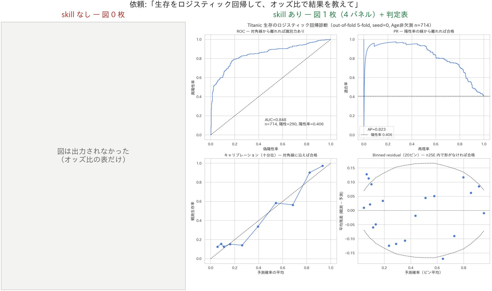
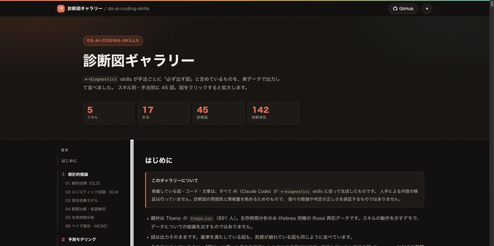

<div align="center">


# ds-ai-coding-skills

**回帰や検定を AI に頼むと、その診断の図と値まで一緒に返ってくる。**<br>
データ分析のための Agent Skills 集（Claude Code / GitHub Copilot / Codex 対応）

[](https://github.com/atsushi-green/ds-ai-coding-skills/actions/workflows/ci.yml)
[](https://www.python.org/)
[](https://docs.astral.sh/uv/)
[](https://docs.astral.sh/ruff/)
[](https://pola.rs/)
<br>
[](https://docs.anthropic.com/en/docs/claude-code)
[](https://github.com/features/copilot)
[](https://openai.com/codex/)
[](LICENSE)


</div>

---

AI コーディングエージェントに「ロジスティック回帰して」と頼むと、係数とオッズ比は返ってきます。
しかし、その推定を信用してよいかの確認（多重共線性、当てはまり、キャリブレーション）は、頼まない限り省かれがちです。

このリポジトリの `*-diagnostics` skill は、分析手法ごとに「実行したら必ず一緒に出す図と値」を決めておき、頼まなくても出させます。

## 同じ依頼を、skill なし・ありで比べる

同じ依頼を、同じモデル（Claude Opus 5.5）に、診断 skill を外した状態と入れた状態で 3 回ずつ投げた結果です。

> data/raw/train.csv（Titanic）で、生存 Survived を性別・客室等級・年齢・運賃で説明するロジスティック回帰をして、オッズ比で結果を教えて。

| | skill なし | skill あり |
|---|---|---|
| オッズ比と 95% 信頼区間 | 出る | 出る |
| 診断の図 | 3 回とも 0 枚 | 3 回とも ROC・PR・キャリブレーション・binned residual を出力 |
| 診断の値 | 3 回とも無し。うち 1 回は報告に「モデルの当てはまりの良さや、変数どうしの相関の強さは確認していません」 | 3 回とも VIF・EPV・AUC・Brier score など 8 項目を、実測値・合格基準・判定の表で報告 |



3 つの手法（ロジスティック回帰・予測モデルの評価・k-means）を 3 回ずつ実行すると、skill が「必ず出す」と定めた 37 項目は、
skill ありで 111 回中 111 回、skill なしで 46 回出ました。`AGENTS.md` に「診断の図と値も出す」と 1 行書くだけの場合は 58 回です。
この比較をもとに、skill なしでも出る指示と、無くても同じ結果になったコード例は skill から削っています。
比べ方、費用が約 1.7 倍になること、制約は [比較結果の全文](docs/skill-ablation.md) にあります。

## 使ってみる

入れ方は 3 通りあります。入れたあとは、いつもどおり分析を頼むだけです。診断に触れる必要はありません。

### 診断 skill だけを、いまのリポジトリに入れる

```bash
npx skills add atsushi-green/ds-ai-coding-skills
```

表示される一覧から、名前が `-diagnostics` で終わる 5 つを選びます（[skills CLI](https://github.com/vercel-labs/skills) が、
Claude Code や Codex など選んだエージェントの置き場所にコピーします）。選択の操作を省くなら、名前を指定します。

```bash
npx skills add atsushi-green/ds-ai-coding-skills \
  --skill statistical-inference-diagnostics --skill predictive-modeling-diagnostics \
  --skill causal-inference-diagnostics --skill unsupervised-eda-diagnostics \
  --skill simulation-optimization-diagnostics
```

5 つの skill は他のファイルを参照しません。`.claude/skills/<名前>/` をディレクトリごと手でコピーしても動きます。

### Claude Code の plugin として入れる

```bash
claude plugin install ds-diagnostics --marketplace atsushi-green/ds-ai-coding-skills
```

Claude Code 2.1.275 以降で使えます（セッションの中では `/plugin install ds-diagnostics --marketplace atsushi-green/ds-ai-coding-skills`）。
plugin の skill はプロジェクトの外に置かれるので、手法別の references を読むときに読み取りの許可を求められたら、許可してください。
無人実行（`claude -p`）で使う場合は、plugin の置き場所の読み取りをあらかじめ許可しておく必要があります。
プロジェクトの中に skill を置く上の方法なら、この許可は要りません。

### テンプレートとして丸ごと使う

GitHub の **Use this template** から新しいリポジトリを作るか、clone して使います。
診断 skill に加えて、次のものが入ります。

- ルーター文書 `CLAUDE.md`（Claude Code）と `AGENTS.md`（Copilot / Codex）。ハードルールとスキルのルーティング表を持ち、タスクに応じて該当する skill を適用させます
- 基本 skill（Python の書き方、polars、SQL、可視化、データの安全な扱い、分析結果の報告など）
- タスク実行用の skill。Claude Code ではスラッシュコマンドとしても呼べます（例: `/plan-analysis`、`/review-sql`）
- raw データや秘密情報のコミットを検知する CI

セットアップは [テンプレートとして使うときのセットアップ](#テンプレートとして使うときのセットアップ) を参照してください。

## 入っている診断 skill

5 つのルーターが、19 の手法別 references に振り分けます。常に読み込まれるのはルーターの説明文だけで、
手法別の本文（必ず出す図・必ず出す値・落とし穴）は、その手法を使うときにだけ読まれます。

| skill（ルーター） | 手法（references） |
|---|---|
| `statistical-inference-diagnostics` | 線形回帰、GLM（ロジスティック・ポアソンなど）、混合効果・パネル、仮説検定、生存時間分析、ベイズ推定（MCMC） |
| `predictive-modeling-diagnostics` | 予測モデルの評価（分割・交差検証・リーク）、決定木・ランダムフォレスト・GBDT、モデル解釈（SHAP など）、時系列 |
| `causal-inference-diagnostics` | A/B テスト、傾向スコア・IPW・DML、差の差・操作変数・回帰不連続・合成コントロール |
| `unsupervised-eda-diagnostics` | 欠測・外れ値、クラスタリング、次元削減、異常検知 |
| `simulation-optimization-diagnostics` | モンテカルロ・離散事象シミュレーション、LP / MIP・メタヒューリスティクス |

報告には、診断項目ごとに実測値・合格基準・判定（`OK` / `要対処` / `確認`）・次アクションを並べた表が付きます。
各手法でどんな図が出るかは、次のギャラリーで確認できます。

## 診断図ギャラリーの見方

各 `*-diagnostics` skill が「実行したら必ず出す」と定めた図を、実データ（Titanic ほか）で
出力して並べたものが [診断図ギャラリー](https://atsushi-green.github.io/ds-ai-coding-skills/) です。
「このskillを使うと、どの手法でどんな図・判定が出てくるのか」を手を動かさずに確認できます。

トップページには「①統計的推論」「②予測モデリング」「③因果推論」「④教師なし・EDA」
「⑤シミュレーション・最適化」の5スキル・17手法・45図が並びます。左の目次から見たい手法に
ジャンプできます。



各手法のセクションには、題材（使ったモデル・データ）、判定バッジ（`OK` / `確認` / `要対処`。
件数つき）、そして実際に出力された図がそのまま並びます。「絞り込み」で `要対処を含む手法` だけに
表示を絞ることもできます。


- 図の雛形は AI が diagnostics skill に従って生成したもので、人手レビューは行っていません。数値や
  判定の正しさの保証ではなく、「このskillを使うとこういう図が出る」という雰囲気を掴むためのものです。
- ソースは [docs/gallery/](docs/gallery/)。デプロイは `.github/workflows/pages.yml`。

## 関連リンク

| | リンク | 内容 |
|:-:|---|---|
| 📊 | [**診断図ギャラリー**](https://atsushi-green.github.io/ds-ai-coding-skills/) | 各 `*-diagnostics` skill が「必ず出す」と定めた図を、実データで出力して並べたもの |
| 🔬 | [**診断 skill は本当に要るのか**](docs/skill-ablation.md) | skill を外して同じ依頼を投げ、「必ず出す」図と値がどれだけ出るかを比べた結果 |
| 📝 | [**データサイエンティストのためのAGENTS.mdとSkills**](https://zenn.dev/green_tea/articles/d310e5cf809190) | ルーター文書（`AGENTS.md`）と、Python・SQL・データ処理・可視化などの基本 skill の設計 |
| 📝 | [**続・データサイエンティストのためのSkills:分析手法×診断可視化セット**](https://zenn.dev/green_tea/articles/55d2761106ee74) | `*-diagnostics` skill 群（図と値をセットで出させる仕組み）の設計と動作例 |

## テンプレートとして使うときのセットアップ

### 前提条件

- Python 3.13（`.python-version` に書いてあり、`uv sync` がこの版で環境を作ります）
- [uv](https://docs.astral.sh/uv/) がインストール済みであること

### インストール

```bash
uv sync
```

### 主要コマンド

```bash
uv sync                                              # 依存関係のインストール・同期
uv run pytest                                         # テスト実行
uv run ruff check .                                   # リント
uv run ruff format .                                  # フォーマット
uv run mypy src                                       # 型チェック
uv run python scripts/check_no_raw_data_commit.py     # rawデータのコミットチェック
uv run python scripts/check_no_sensitive_patterns.py   # 秘密情報パターンの検出
uv run python scripts/validate_agent_docs.py           # エージェント文書の検証
bash scripts/run_quality_checks.sh                     # 全品質チェック一括実行
```

## ディレクトリ構成

```
.
├── AGENTS.md                          # Copilot / Codex 用ルーター（CLAUDE.md と同内容）
├── CLAUDE.md                          # Claude Code 用ルーター（ハードルール・スキルルーティング）
├── .github/
│   ├── workflows/ci.yml               # GitHub Actions CI
│   ├── instructions/                  # パス別補助指示（Copilot の applyTo 用）
│   └── prompts/                       # 再利用プロンプト（Copilot）
├── .claude-plugin/
│   └── marketplace.json               # 診断 skill を Claude Code の plugin として配るための定義
├── .claude/
│   └── skills/                        # 作業別スキルの唯一の置き場（3ツール共通。旧スラッシュコマンドを含む）
│                                      #   *-diagnostics は2段構成: ルーター SKILL.md + references/<method>.md
├── .agents/
│   └── skills -> ../.claude/skills    # Codex 用シンボリックリンク
├── docs/
│   ├── agent/                         # このリポジトリ固有の知識のみ（概要・データカタログ・指標定義）
│   └── gallery/                       # 診断図ギャラリー（GitHub Pages で公開。図はデモの出力をメンテナの手元で変換して配置）
├── data/
│   ├── raw/                           # 元データ（不変・gitignore対象）
│   ├── external/                      # 外部データ（不変・gitignore対象）
│   ├── interim/                       # 中間加工データ
│   └── processed/                     # 最終加工データ
├── notebooks/                         # 分析用Notebook
├── outputs/
│   ├── figures/                       # グラフ・図
│   ├── tables/                        # 集計テーブル
│   └── reports/                       # レポート
├── scripts/                           # CI・検証スクリプト
│   └── skill_eval/                    #   skill 発火テスト（run_skill_eval.py から手動実行）
├── src/analysis_project/              # 再利用可能なPythonモジュール
└── tests/                             # テスト
```

## 設計の詳細

指示体系の設計（なぜ `CLAUDE.md` と `AGENTS.md` の2ファイルなのか）、スキル一覧、
`*-diagnostics` skill の2段構成、エージェント文書の同期方法、データの安全性ルール、
パッケージ管理方針などの技術的詳細は **[docs/architecture.md](docs/architecture.md)** に
まとめています。
