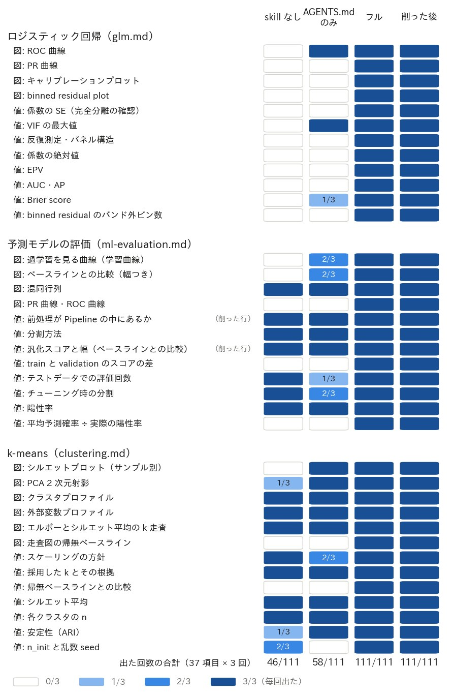
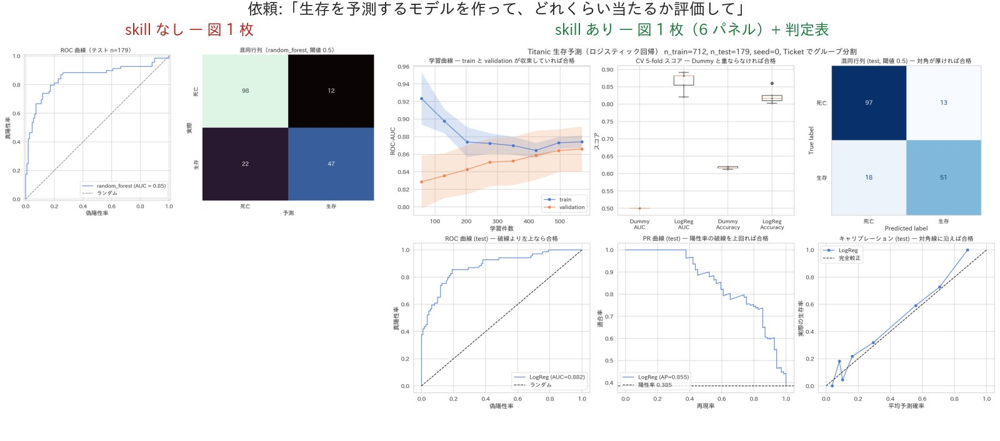

# 診断 skill は本当に要るのか — skill を外して比べ、要らない指示を削った結果

`*-diagnostics` skill は、分析手法ごとに「一緒に出すべき図と値」を定めたものです。
モデルが賢くなれば、書かなくても同じものを出すかもしれません。
そこで、診断の指示を外した条件と比べ、外しても出てくる指示を skill から削りました。

## 結論

- **skill が「必ず出す」と定めた 37 項目を 3 回ずつ数えると、フルは 111 回中 111 回、skill なしは 46 回でした。**
- 診断 skill を置かず、ルーター文書（`AGENTS.md` / `CLAUDE.md`）に「診断の図と値をセットで出す」と 1 行だけ書いた条件（以下「AGENTS.md のみ」）は 58 回です。1 行で増えたのは ROC 曲線・VIF・シルエットプロットのような有名な診断で、binned residual・EPV・帰無ベースラインなどは 1 回も出ませんでした。
- ロジスティック回帰は、skill なしでは 3 回とも図が 0 枚でした。
- skill なしでも毎回出た項目は 14 個ありました。このうち行ごと削れたのは 2 行です。残りは、合格基準を持つ行か、今回試せていない条件分岐を含む行でした。
- 削れたのは主にコード例です。今回試した手法のコード例を外しても、37 項目は 111 回中 111 回出ました。3 本の references は 312 行から 222 行になりました。

各条件 3 回、3 ケースだけの結果です（[制約](#制約)を参照）。

## 比べ方

| 項目 | 内容 |
|---|---|
| モデル | Claude Opus 5.5（`claude-opus-5-5`）、effort は `medium` |
| 実行環境 | Claude Code 2.1.310 の headless 実行（`claude -p`）。2026-11-14〜15 に実行 |
| ケース | 発火テストのケースから、手法の種類と頼み方が重ならない 3 件。プロンプトは skill にも診断にも触れていない |
| 回数 | 各条件 3 回（3 条件 × 3 ケース × 3 回 = 27 実行）。削ったあとの確認に 9 実行 |

| 条件 | 診断についての指示 |
|---|---|
| skill なし | なし。5 つのルーターと 19 本の references、それに触れる記述（`CLAUDE.md` の Hard Rule とルーティング表の行、`analysis-reporting` の診断サマリー節、`statistical-ml-review`）を外す |
| AGENTS.md のみ | skill なしと同じものを外したうえで、`CLAUDE.md` の Hard Rules に 1 行だけ足す: `When applying a statistical, ML, causal, simulation, or optimization method, always output its diagnostics with it (図と値をセットで出す).` |
| フル | リポジトリのまま |
| 削った後 | フルから、下の「削ったもの」を除いたもの |

どの条件でも、`visualization` などの基本 skill は残し、README は見出しだけに差し替えています（README には診断 skill の説明とこの比較の結果が書いてあるため）。
実行のたびにリポジトリの外に新しい作業ディレクトリを作り、条件に合わせて外した状態を最初のコミットにしています。

| ケース | プロンプト | 対応する reference |
|---|---|---|
| ロジスティック回帰 | data/raw/train.csv（Titanic）で、生存 Survived を性別・客室等級・年齢・運賃で説明するロジスティック回帰をして、オッズ比で結果を教えて。 | `glm.md`（二値） |
| 予測モデルの評価 | Titanic（data/raw/train.csv）で乗客の生存を予測するモデルを作って、どれくらい当たるか評価して。 | `ml-evaluation.md`（分類） |
| k-means | Titanic（data/raw/train.csv）の乗客を k-means でセグメントに分けて、それぞれの特徴を教えて。 | `clustering.md`（k-means） |

### 採点

references の「必ず出す図」「必ず出す値」を 1 項目ずつに分け、項目ごとに「出たか、出ないか」を数えました（3 本で 37 項目）。
判定は正規表現で機械的に行っています（[採点表](../scripts/skill_eval/checklists.yaml)）。

- 図の項目: 生成されたスクリプトに描画のための関数（`roc_curve(` など）があり、図のファイルが保存されている
- 値の項目: 最終報告か保存された表に、その診断の名前（VIF、EPV など）が現れる。「確認していません」のような否定の文は数えない

採点表は、結果を目で確かめて 2 回直しました。出ているのに数えていなかった 14 セル（「学習データと検証データのスコア差」のような言い回しの違い）を直し、途中で入った誤検出 1 セル（「交差検証」の「差」に当たっていた）を除いています。
見ているのは「出たか」だけで、図や判定の中身が正しいかは確かめていません。

## 結果



| | skill なし | AGENTS.md のみ | フル | 削った後 |
|---|---|---|---|---|
| ロジスティック回帰（12 項目 × 3 回） | 0/36 | 7/36 | 36/36 | 36/36 |
| 予測モデルの評価（12 項目 × 3 回） | 21/36 | 22/36 | 36/36 | 36/36 |
| k-means（13 項目 × 3 回） | 25/39 | 29/39 | 39/39 | 39/39 |
| 合計 | 46/111（41%） | 58/111（52%） | 111/111 | 111/111 |
| 判定表が付いた実行 | 0/9 | 0/9 | 9/9 | 9/9 |
| 1 実行あたりの費用と時間 | 0.54 ドル・3.0 分 | 0.66 ドル・3.2 分 | 0.90 ドル・3.5 分 | 0.91 ドル・3.4 分 |

### ロジスティック回帰: 頼まれたものだけが返る


skill なしは、3 回ともオッズ比と信頼区間だけを返しました。図は 0 枚で、12 項目は 1 つも出ていません。
3 回のうち 1 回は、報告の注意点に「モデルの当てはまりの良さや、変数どうしの相関の強さは確認していません」と書いていました。

AGENTS.md のみの条件で毎回出たのは、ROC 曲線と VIF の 2 つです。PR 曲線、キャリブレーション、binned residual、EPV は 1 回も出ませんでした。

### 予測モデルの評価: 基本は書かなくても出る



依頼が「評価して」なので、評価の基本は頼まれた範囲に入っています。
skill なしでも、Pipeline による前処理、層化した分割、ベースラインとの比較、テストデータでの評価を 1 回に限ること、陽性率の報告は 3 回とも出ました。

skill なしで 1 回も出なかったのは、学習曲線、ベースラインと並べた図、PR 曲線、train と validation の差、平均予測確率と陽性率の比です。

### k-means: 1 行で増えるもの、増えないもの


エルボーとシルエットによる k の走査、クラスタごとの人数と特徴は、skill なしでも毎回出ました。
AGENTS.md のみの条件では、シルエットプロット、PCA 射影、安定性（ARI）が毎回出るようになりました。
一方、列ごとの順列で作る帰無ベースラインは、skill なしでも AGENTS.md のみでも 1 回も出ていません。

採用したクラスタ数は、どの条件でも実行ごとに変わりました（skill なし 6・4・7、AGENTS.md のみ 6・6・8、フル 4・4・6、削った後 3・4・3）。
使う特徴量が実行ごとに違うので、どれが正しいかは比べられません。

## 削ったもの、残したもの

削る基準は、結果を見る前に「skill なしで 3 回とも出た項目だけを削る」と決めていました。該当したのは 14 項目です。
結果を見てから、基準を 2 つ厳しくしました。

1. AGENTS.md のみの条件でも 3 回とも出ていること（6 回中 6 回）。14 項目のうち 11 項目が残りました。
2. その行の内容が、今回のケースですべて試せていること。「分割方法」の行は時系列やグループの分割を、「チューニング時の分割」の行は nested CV を含みますが、今回のケースでは試せていません。合格基準と違反時の対処を持つ行（クラスタの人数が 5% 未満なら k を減らす、など）も残しました。

| | 内容 | 行数 |
|---|---|---|
| 削った行 | `ml-evaluation.md` の「前処理が Pipeline 内か」「汎化スコアと幅」 | 2 |
| 削ったコード例 | 今回試した手法（二値の GLM、分類の評価、k-means）の取得例 | 88 |
| 残したもの | 残りの 35 項目の行、合格基準、落とし穴、試していない手法（カウントの GLM、階層・GMM・DBSCAN）のコード例 | 222 |

コード例は、skill なしとの比較からは要否が分かりません。そこで、削ったあとの skill で同じ 9 実行を行って確かめました。

- 37 項目は、111 回中 111 回出ました。削った 2 行の項目（Pipeline、ベースラインとの比較）も 3 回とも出ています。
- コード例に書いてあった細部 12 個（VIF を定数項込みで計算する、性能は学習に使っていないデータで出す、キャリブレーションを十分位で区切る、帰無ベースラインを列ごとの順列で 20 本作る、など）も、削る前と同じく 3 回とも保たれていました。これらは「必ず出す図・値」の表にも書いてあります。

3 本の references は 312 行から 222 行（`glm.md` 114 → 80、`ml-evaluation.md` 82 → 53、`clustering.md` 116 → 89）になりました。診断 skill 全体では 2,072 行から 1,982 行です。残りの 16 本は比べていないので、手を付けていません。

## 読み取れること

**頼まれた範囲の外にある確認は、skill が無いと出ない。**
「ロジスティック回帰して、オッズ比を教えて」にはオッズ比だけが返り、「評価して」と頼んだケースでは評価の基本が出ました。
モデルは診断のやり方を知らないのではなく、頼まれていないので省いています。

**「診断も出して」の 1 行で出るのは、有名な診断まで。**
ROC 曲線や VIF は 1 行で出ますが、binned residual、EPV、帰無ベースライン、平均予測確率と陽性率の比は出ません。
何を出すかを具体的に書いた表は、1 行では置き換えられませんでした。

**書き方（コード例）は、今回の 3 本では要らなかった。**
何を、どの条件で出すかが表に書いてあれば、コード例が無くても同じ図と値が出ました。
コード例はライブラリの更新で動かなくなるので、保守の手間が減ります。

**skill は費用を増やす。**
フルは skill なしに比べて、1 実行あたりの費用が約 1.7 倍でした。90 行削っても費用は変わっていません。

## 制約

- **3 ケースだけです。** 19 本の references のうち、比べたのは 3 本です。削ったのもその 3 本だけです。
- **モデルと effort は 1 通りです。** 別のモデルや effort では、skill なしで出る項目も、コード例の要否も変わる可能性があります。Copilot や Codex では試していません。
- **各 3 回です。** 3 回とも出た場合でも、出現率の 95% 信頼区間の下限は 0.29 です。削った指示が要る場面が残っている可能性はあります。
- **採点は正規表現です。** 出たかどうかだけを見ていて、中身の正しさは見ていません。コード例の細部の確認も、スクリプトに正規表現を当てただけです。
- **題材は Titanic だけです。** 扱いにくいデータでは、コード例が効く可能性があります。
- **実行した端末の個人設定は全条件で同じです。** ユーザーレベルで入れている skill や plugin は、どの条件にも同じように入っています。

## 再現方法

前提（`claude` へのログイン、`data/raw/train.csv` の配置）は [scripts/skill_eval/README.md](../scripts/skill_eval/README.md) を参照してください。

```bash
CASES=glm-explicit,mleval-implicit,cluster-kmeans
OPTS="--only $CASES --model claude-opus-5-5 --effort medium --repeat 3"
uv run python scripts/run_skill_eval.py run $OPTS --arm no-diagnostics --run-id abl-none
uv run python scripts/run_skill_eval.py run $OPTS --arm agents-md-rule --run-id abl-rule
uv run python scripts/run_skill_eval.py run $OPTS --run-id abl-full
# 項目ごとに「出た回数 / 実行回数」を数える（API は呼ばない）
uv run python scripts/run_skill_eval.py score outputs/skill_eval/abl-none outputs/skill_eval/abl-rule outputs/skill_eval/abl-full
```

削る前のフルを再現するには、references を削る直前のコミット `d1c4d46` で実行してください。それより後のコミットでは、フルの条件が「削った後」になります。
実行結果（transcript、生成されたスクリプトと図）は `outputs/skill_eval/` に出力されます。transcript に行レベルのデータが残りうるため、リポジトリには含めていません。
