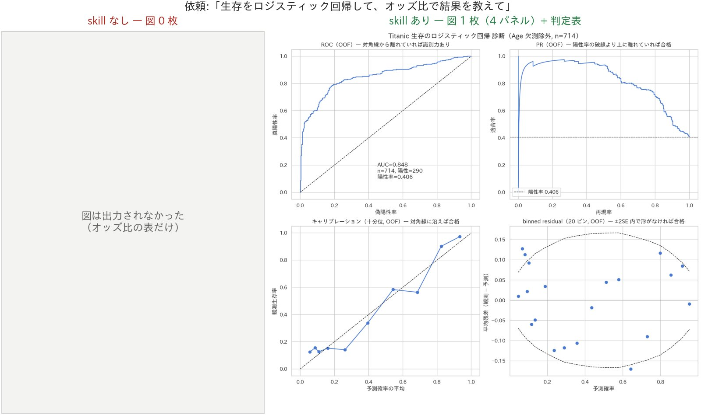
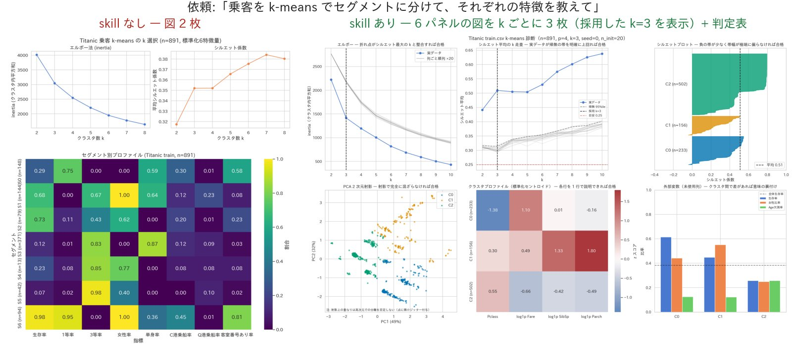

# 診断 skill は本当に要るのか — skill を外して同じ依頼を投げた結果

`*-diagnostics` skill は、分析手法ごとに「一緒に出すべき図と値」を定めたものです。
ただ、モデルが賢くなれば、書かなくても同じものを出すかもしれません。
そこで、診断 skill を外したリポジトリと外していないリポジトリで、同じ依頼を同じモデルに投げて比べました。

## 結論

- **skill ありは、references が「必ず出す」と定めた 37 項目をすべて出しました。skill なしが出したのは 13 項目です**（一部だけ出たものが 5、出なかったものが 19）。
- 差が最も大きかったのはロジスティック回帰です。skill なしはオッズ比の表だけを返し、図は 0 枚でした。報告には「モデルの当てはまりの良さや、変数どうしの相関の強さは確認していません」と書かれていました。
- 予測モデルの評価では、skill なしでも基本は押さえていました。ベースラインとの比較、リークを避けた前処理、テストデータでの評価を 1 回に限ることは、書かなくても出ました。
- k-means では結論そのものが変わりました。skill なしは 7 クラスタ（うち 1 つは 13 人）を採用し、skill ありは診断を見て 3 クラスタを採用しました。
- 費用は skill ありが約 1.5 倍です（3 ケース合計で 2.25 ドルと 1.52 ドル）。

各条件 1 回ずつの実行なので、数字は傾向として読んでください（[制約](#制約)を参照）。

## 比べ方

| 項目 | 内容 |
|---|---|
| モデル | Claude Opus 5.5（`claude-opus-5-5`）、effort は `medium` |
| 実行環境 | Claude Code 2.1.310 の headless 実行（`claude -p`）。実行日は 2026-11-14 |
| skill あり | このリポジトリをそのまま使う |
| skill なし | `*-diagnostics` の 5 ルーターと 19 references、それを指す記述（`CLAUDE.md` の Hard Rule とルーティング表の行、`analysis-reporting` の診断サマリー節、`statistical-ml-review`、README の本文）を外す。`visualization` や `analysis-reporting` などの基本 skill は残す |
| ケース | 発火テストの基本セットから、手法の家族が異なる 3 件。プロンプトは下の表のとおりで、skill にも診断にも触れていない |
| 回数 | 各条件 1 回 |

| ケース | プロンプト | 対応する reference |
|---|---|---|
| ロジスティック回帰 | data/raw/train.csv（Titanic）で、生存 Survived を性別・客室等級・年齢・運賃で説明するロジスティック回帰をして、オッズ比で結果を教えて。 | `glm.md`（二値） |
| 予測モデルの評価 | Titanic（data/raw/train.csv）で乗客の生存を予測するモデルを作って、どれくらい当たるか評価して。 | `ml-evaluation.md`（分類） |
| k-means | Titanic（data/raw/train.csv）の乗客を k-means でセグメントに分けて、それぞれの特徴を教えて。 | `clustering.md`（k-means） |

実行のたびに、リポジトリの外に新しい作業ディレクトリを作り、そこでエージェントを起動しています。
skill なしの条件では、skill を外した状態を最初のコミットにしているので、エージェントからは「最初から診断 skill が無いリポジトリ」に見えます。

照合は次の手順で行いました。

1. 各 reference の「必ず出す図」「必ず出す値」を項目に分ける。表や箇条書きの 1 行を 1 項目とし、1 行に複数の図があるものは図ごとに分ける。条件つきの項目（「確率を使う場合」のキャリブレーション図など）は数えない。
2. 最終報告、生成されたスクリプト、図を読み、項目ごとに ○（出ている）・△（一部だけ）・×（出ていない）を付ける。

照合は Claude（Fable 5.2）が行いました。人による再確認はしていません。
見たのは「出ているかどうか」だけで、図や判定の中身が正しいかは確かめていません。

## 結果の一覧

| ケース | 必ず出す項目 | skill あり | skill なし | 判定表（あり / なし） | 時間と費用（あり） | 時間と費用（なし） |
|---|---|---|---|---|---|---|
| ロジスティック回帰 | 12 | ○ 12 | ○ 0 / △ 2 / × 10 | ○ / × | 2.3 分・0.65 ドル | 1.4 分・0.36 ドル |
| 予測モデルの評価 | 12 | ○ 12 | ○ 6 / △ 2 / × 4 | ○ / × | 2.4 分・0.70 ドル | 3.0 分・0.55 ドル |
| k-means | 13 | ○ 13 | ○ 7 / △ 1 / × 5 | ○ / × | 3.7 分・0.91 ドル | 2.8 分・0.61 ドル |
| 合計 | 37 | ○ 37 | ○ 13 / △ 5 / × 19 | 3 件 / 0 件 | 2.25 ドル | 1.52 ドル |

判定表は、診断項目ごとに実測値・合格基準・判定（`OK` / `要対処` / `確認`）・次アクションを並べた表です。
書式は skill が決めているので、skill なしの側に無いのは当然です。
ただし skill なしの報告には、基準に照らして合否を述べる記述そのものがほとんどありませんでした。

## ロジスティック回帰



オッズ比と 95% 信頼区間は、両方の条件で同じ値でした（男性 0.081、2 等 0.279、3 等 0.079、年齢 10 歳あたり 0.693、運賃 10 ポンドあたり 1.005）。違いは、その推定を信用してよいかを確かめたかどうかです。

| 必ず出す項目（`glm.md`・二値） | skill あり | skill なし |
|---|---|---|
| 図: ROC 曲線（AUC・陽性率・n を併記） | ○ | × |
| 図: PR 曲線（陽性率の水平線） | ○ | × |
| 図: キャリブレーションプロット（十分位） | ○ | × |
| 図: binned residual plot（±2SE のバンド） | ○ | × |
| 値: 係数の SE（完全分離の一次判定） | ○ | △ 表の列にはあるが、分離の確認には使っていない |
| 値: VIF の最大値 | ○ 2.67 | × |
| 値: 反復測定・パネル構造の有無 | ○ | × |
| 値: 係数の絶対値 | ○ | △ 同上 |
| 値: EPV（少ない側の件数 ÷ 変数の数） | ○ 58.0 | × |
| 値: AUC・AP | ○ 0.848 / 0.823 | × |
| 値: Brier score | ○ 0.146（基準値 0.241） | × |
| 値: binned residual のバンド外ビン数 | ○ 20 ビン中 3 | × |

skill なしの報告は、注意点として次のように書いていました。

> モデルの当てはまりの良さや、変数どうしの相関の強さは確認していません。

skill ありの報告には、次の判定表が付きました（最終応答からそのまま引用）。

| 診断項目 | 実測値 | 合格基準 | 判定 | 次アクション |
|---|---|---|---|---|
| 収束 / 完全分離 | 収束済み、SE 最大 0.46、\|係数\| 最大 3.72、クロス表の最小セル 64 | SE<100、\|係数\|<10、0 のセルなし | OK | — |
| VIF の最大値 | 2.67 | <10 | OK | — |
| EPV（少ない側の件数 ÷ 変数の数） | 58.0 | ≥10 | OK | — |
| AUC / AP（予測精度、5-fold で学習に使っていないデータで評価） | 0.848 / 0.823（陽性率 0.406、n=714、生存 290） | 文脈依存 | OK | — |
| Brier スコア（予測確率の誤差） | 0.146 | 0.241（陽性率から計算した基準値）より小さい | OK | — |
| binned residual（予測確率帯ごとの残差）の帯外ビン数 | 20 ビン中 3 | ≤3 で、外れ方に形がない | 確認 | 件数は上限ちょうどです。図では予測 0.2〜0.4 の帯で負の残差が続き、両端では正寄りでした。キャリブレーション図でも 0.25 付近を過大に予測しています。関数形が合っていない可能性があるので、性別×等級の交互作用や年齢のスプライン（非線形化）を入れたモデルとの比較を提案します（今回は実施していません） |
| 反復測定の構造 | なし（1行=乗客1人） | — | OK | — |
| Age 欠測による除外 | 177/891 行を除外。生存率は欠測行 0.294、観測行 0.406 | 欠測行と観測行で生存率に偏りがない | 確認 | 欠測行は生存率が低く、無作為な欠測ではない可能性があります。多重代入（欠測値の補完）での感度分析を検討してください |

「確認」が 2 件あります。関数形が合っていない可能性と、年齢の欠測が無作為でない可能性です。
どちらも、オッズ比の表だけを見ていては気づけません。

## 予測モデルの評価


3 ケースの中で、skill なしが最もよく出したケースです。依頼が「評価して」なので、評価の基本は頼まれた範囲に入っています。

| 必ず出す項目（`ml-evaluation.md`・分類） | skill あり | skill なし |
|---|---|---|
| 図: 過学習を見る曲線（学習曲線） | ○ | × |
| 図: ベースラインとの比較（幅つき） | ○ 箱ひげ図 | △ 図は無い。表で、交差検証の平均 ± SD を 2 種類のベースラインと並べている |
| 図: 混同行列（閾値を明記） | ○ | ○ |
| 図: PR 曲線・ROC 曲線 | ○ | × AUC の値だけ |
| 値: 前処理が Pipeline の中にあるか | ○ | ○ |
| 値: 分割方法とその理由 | ○ 層化に加えて、同じチケットの同行者をまとめた分割でも確認 | △ 層化は理由つき。同行者というグループ構造は見ていない |
| 値: 汎化スコアと幅（ベースラインとの比較） | ○ | ○ 「全員死亡」と「性別だけ」の 2 種類と比較 |
| 値: train と validation のスコアの差 | ○ 0.013 | × |
| 値: テストデータでの評価回数 | ○ 1 回 | ○ 1 回 |
| 値: チューニング時の分割 | ○ チューニングなしと明記 | ○ 同じ |
| 値: 陽性率 | ○ | ○ |
| 値: 平均予測確率 ÷ 実際の陽性率 | ○ 0.958 | × |

条件つきの項目であるキャリブレーション図は、skill ありだけが出しました（skill なしは確率を判断に使っていないので、対象外として数えていません）。

skill なしで出なかったのは、予測確率の質（キャリブレーション）、過学習の確認（学習曲線、train と validation の差）、グループ単位のリークの確認です。

## k-means



| 必ず出す項目（`clustering.md`・k-means） | skill あり | skill なし |
|---|---|---|
| 図: シルエットプロット（サンプル別） | ○ | × |
| 図: PCA 2 次元射影 | ○ | × |
| 図: クラスタプロファイル（各クラスタの n を併記） | ○ | ○ |
| 図: 外部変数プロファイル（クラスタリングに使わなかった列） | ○ | ○ 生存率などを同じヒートマップに載せている |
| 図: エルボーとシルエット平均の k 走査 | ○ k = 2〜10 | ○ k = 2〜8 |
| 図: 走査図に重ねる帰無ベースラインの帯 | ○ | × |
| 値: スケーリングの方針 | ○ | ○ |
| 値: 採用した k とその根拠 | ○ | ○ シルエット最大。k = 3〜8 が横並びとも書いている |
| 値: 帰無ベースラインとの比較 | ○ 0.51（帰無の 95% 点は 0.31） | × |
| 値: シルエット平均 | ○ 0.51 | ○ 0.38 |
| 値: 各クラスタの n（極小クラスタへの注記） | ○ 最小 17.5% | ○ 13 人のセグメントを「参考値」と注記 |
| 値: 安定性（サブサンプルの ARI） | ○ 中央値 0.996 | × 「確認していません」と明記 |
| 値: `n_init` と乱数 seed | ○ | △ スクリプトでは固定しているが、報告に書いていない |

このケースでは、採用したクラスタ数が違いました。

- **skill なし**: シルエット平均が最大になる k = 7 を採用しました。7 つのうち 1 つは 13 人（全体の 1.5%）です。
- **skill あり**: 最初の実行ではシルエット最大の k = 10 が候補になりました。しかし 15 人（1.7%）の極小クラスタができること、特徴量が離散値なので k を増やすほどシルエットが上がり続けることを診断から読み取り、エルボーが折れる k = 3 を採用しました。

2 つの条件は使った特徴量が違うので（skill なしは性別と年齢を含む 6 列、skill ありは 4 列）、どちらの k が正しいかは比べられません。
言えるのは、「シルエット最大で k を決めると極小クラスタができる」という同じ状況で、skill ありだけがそれを判断材料にしたということです。

## 読み取れること

**頼まれた範囲の外にある確認は、skill が無いと出にくい。**
「ロジスティック回帰して、オッズ比を教えて」には、オッズ比だけが返ってきました。
「評価して」と頼んだケースでは評価の基本が出ています。
モデルは診断のやり方を知らないのではなく、頼まれていないので省いています。
skill なしの報告が「確認していません」と自分で書いているのは、その表れです（3 件中 2 件）。

**skill なしでも出た項目は、書かなくてよい候補です。**
今回の 3 ケースでは次の項目が該当します。1 回ずつの結果なので、削る前に回数を増やして確かめる必要があります。

- `ml-evaluation.md`: 前処理を Pipeline に入れる、ベースラインと幅つきで比べる、テスト評価は 1 回、陽性率を報告する、混同行列
- `clustering.md`: スケーリングの方針、エルボーとシルエットによる k の走査、シルエット平均、クラスタごとの n、プロファイル

**skill が効いていた項目は、分析結果を疑うための確認です。**

- `glm.md`: 12 項目すべて
- `ml-evaluation.md`: 学習曲線、キャリブレーション、グループ単位のリークの確認、train と validation の差
- `clustering.md`: 帰無ベースライン、安定性、シルエットプロット、PCA 射影

**費用は増えます。** skill ありは図と値を多く出すぶん、3 ケース合計で約 1.5 倍の費用がかかりました。

## 制約

- **各条件 1 回の実行です。** 同じ条件でも実行ごとに出力は変わるので、項目数の差には実行ごとのばらつきが含まれます。
- **3 ケースだけです。** 発火テストの 68 ケースのうち 3 件、19 references のうち 3 本しか見ていません。
- **モデルと effort は 1 通りです。** effort を上げれば、skill なしでも出る項目が増える可能性があります。
- **照合は AI が行いました。** 人による再確認はしていません。「出ているか」を見ただけで、判定の中身の正しさは確かめていません。
- **skill ありの条件には README もあります。** README は診断 skill の説明を含むので、skill なしの条件では本文を外しました。2 条件の差は「診断 skill とその説明書き」の有無です。
- **実行した端末の個人設定は両条件で同じです。** ユーザーレベルで入れている skill や plugin は、どちらの条件にも同じように入っています。
- 実行の途中で Claude の利用上限に当たり、6 件中 3 件は同じ日に同じ条件で実行し直しました。

## 再現方法

前提（`claude` へのログイン、`data/raw/train.csv` の配置）と費用の目安は [scripts/skill_eval/README.md](../scripts/skill_eval/README.md) を参照してください。

```bash
# skill あり
uv run python scripts/run_skill_eval.py run --only glm-explicit,mleval-implicit,cluster-kmeans \
  --model claude-opus-5-5 --effort medium --run-id ablation-full
# skill なし（*-diagnostics とそれを指す記述を外す）
uv run python scripts/run_skill_eval.py run --only glm-explicit,mleval-implicit,cluster-kmeans \
  --model claude-opus-5-5 --effort medium --arm no-diagnostics --run-id ablation-no-diagnostics
# 2 つの結果を横に並べたレポートを作る（API は呼ばない）
uv run python scripts/run_skill_eval.py compare outputs/skill_eval/ablation-full outputs/skill_eval/ablation-no-diagnostics
```

実行結果（transcript、生成されたスクリプトと図）は `outputs/skill_eval/` に出力されます。
transcript に行レベルのデータが残りうるため、リポジトリには含めていません。
